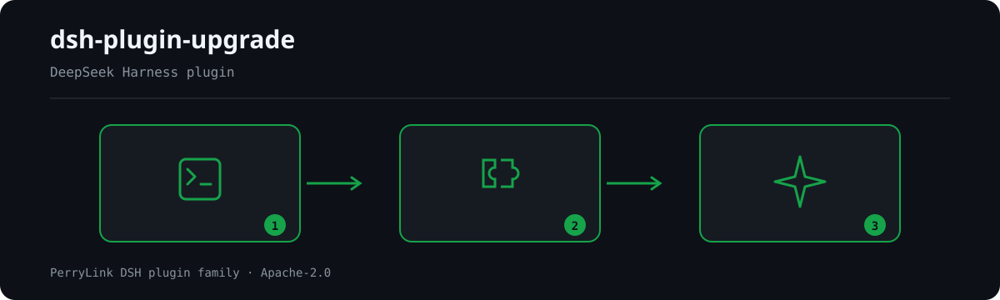

<div align="center">

# ⬆️ dsh-plugin-upgrade
- **Canal da loja 1024**: rode `npm i -g dsh1024` uma vez e depois `dsh1024 plugin --profile web add dsh-plugin-upgrade` (conta para o ranking de instalações do [deepseek1024.com](https://deepseek1024.com)).
[](https://gitee.com/perrylink/dsh-plugin-upgrade)
[](https://dshfind.com/pt/plugins/PerryLink/dsh-plugin-upgrade?ref=badge)

**Habilidade de atualização de plugins para o DeepSeek Harness — um pacote, um índice de corredores, dois corredores fechados: `0.1.3-alpha.1` → `0.1.5-rc.1` (`legAB`) e `0.1.5-rc.2` → `0.1.6-alpha.2` (`legC`).**

*O scanner se encaminha sozinho: lê a faixa dsh declarada pelo repositório alvo (ou aceita `--span`) e então aplica o catálogo próprio daquele corredor, vinculado a evidências — as 20 costuras do `legAB` (perna A `0.1.3-alpha.1` → `0.1.5-alpha.1` mais perna B `0.1.5-alpha.1` → `0.1.5-rc.1`) ou as 5 costuras do `legC` (`E1`–`E5`). Um único ponto de entrada, para que uma metade de cliente que parou de montar em silêncio nunca seja confundida com «typecheck verde».*

> **Repositório oficial.** Este é o único repositório oficial de dsh-plugin-upgrade, mantido pela PerryLink. Ele substitui os dois pacotes retirados com versão travada `dsh-plugin-upgrade` (perna A) e `dsh-plugin-upgrade-rc1` (perna B), e é o pacote no qual o corredor `0.1.5-rc.2` → `0.1.6-alpha.2` (perna C) foi incorporado — o nome `dsh-plugin-upgrade-016` nunca chegou ao registro. Repositórios com o mesmo nome em outras contas não são afiliados. **Tanto `dsh-plugin-upgrade-015` quanto `dsh-plugin-upgrade-016` foram retirados em 2026-10-05 e não recebem mais correções, versões nem atualizações de segurança**; toda atualização de plugins continua aqui, e o corredor é decidido pela versão que o próprio repositório de destino declara, portanto não é mais necessário um pacote com versão travada por salto do host.

[](LICENSE)
[](https://github.com/topics/dsh-plugin)
[](https://github.com/PerryLink/dsh-plugin-doctor#verified-徽章)
[](https://dsh.market/)
[](#)
[](https://github.com/PerryLink/dsh-plugin-upgrade/actions)
[](https://github.com/PerryLink/dsh-plugin-upgrade/releases)
[](https://www.npmjs.com/package/dsh-plugin-upgrade)
[](https://www.npmjs.com/package/dsh-plugin-upgrade)

[English](README.md) · [简体中文](README-zh.md) · [Español](README-es.md) · [Português](README-pt.md) · [हिन्दी](README-hi.md)

```sh
dsh plugin --profile <name> add dsh-plugin-upgrade
```


</div>

---


**📖 Base de conhecimento do ecossistema** — dados medidos, não marketing: [guia de desenvolvimento · dados de seleção · critérios de manutenção](https://perrylink.github.io/dsh-plugin-guide/).

<!-- star-cta -->
## Instalação e desinstalação

```sh
dsh plugin --profile web add dsh-plugin-upgrade            # do npm
dsh plugin --profile web add github:PerryLink/dsh-plugin-upgrade   # do código-fonte
dsh plugin --profile web remove dsh-plugin-upgrade         # desinstalar (reversível)
```

Instalar o bundle apenas registra uma habilidade; remover a linha remove a habilidade. A CLI é um alvo `npx` normal e não precisa de perfil algum.

## ⭐ 如果它帮到了你

Este plugin faz parte da [família de plugins DSH](https://github.com/PerryLink) (mais de 40, todos Apache-2.0). Se for útil, **deixe uma estrela**: não desbloqueia nada, mas ajuda a próxima pessoa a encontrá-lo.

*English:* part of a 95 plugin family for DeepSeek Harness. If it is useful, **a star helps the next person find it** — nothing is gated behind it.

## What is dsh-plugin-upgrade?

Habilidade de atualização de plugins para o DeepSeek Harness — um pacote, um índice de corredores, dois corredores fechados: `0.1.3-alpha.1` → `0.1.5-rc.1` (`legAB`) e `0.1.5-rc.2` → `0.1.6-alpha.2` (`legC`).

O scanner se encaminha sozinho: lê a faixa dsh declarada pelo repositório alvo (ou aceita `--span`) e então aplica o catálogo próprio daquele corredor, vinculado a evidências — as 20 costuras do `legAB` (perna A `0.1.3-alpha.1` → `0.1.5-alpha.1` mais perna B `0.1.5-alpha.1` → `0.1.5-rc.1`) ou as 5 costuras do `legC` (`E1`–`E5`). Um único ponto de entrada, para que uma metade de cliente que parou de montar em silêncio nunca seja confundida com «typecheck verde».



*Visão geral do fluxo: chamada → plugin → resultado. Os exemplos abaixo usam a superfície real de comandos.*


*A mesma execução, animada.*

## Comparison


40 family repos swept · README §What you get (leg A, 2026-09-09)

## Compatibilidade

| Superfície | Estado |
|---|---|
| Harness | DeepSeek Harness `dsh-v0.2.1-alpha.1` (linha atual; pins de dev/test `0.2.1-alpha.1`). O índice de corredores está vinculado à evidência dos trechos que mediu: `legAB` = `0.1.3-alpha.1 → 0.1.5-rc.1` (tag `dsh-v0.1.7-alpha.2` = `183f08e9c6dd`; passagem da perna A→B `dsh-v0.1.7-alpha.2` = `5dda764ed3aa`) e `legC` = `0.1.5-rc.2 → 0.1.6-alpha.2` (tag `dsh-v0.1.7-alpha.2`). Faixa de peers `@deepseek-ai/dsh-skill >=0.1.6-0 <0.2.0 \|\| >=0.2.0-0 <0.3.0 \|\| >=0.2.1-0 <0.3.0`, `@deepseek-ai/cordis ^4.0.5-alpha.1`, `@deepseek-ai/schemastery ^3.18.5-alpha.1`. |
| Node | `^22.19.0 \|\| >=24.0.0` |
| Plataformas | Onde o Node rodar; o scanner só usa o sistema de arquivos e é neutro em relação à plataforma |
| Modelo | Modelos somente texto totalmente suportados; a habilidade é um Markdown, sem exigência de ferramentas ou visão |
| Índice de corredores | Um pacote, um ponto de entrada. `lib/route.mjs` guarda os corredores fechados e a CLI encaminha para o correspondente a partir da faixa declarada do repositório alvo (`engines.dsh`, os intervalos `@deepseek-ai/dsh*`); `--span legAB\|legC` substitui o palpite e uma faixa não declarada recai no corredor mais antigo. Os dois catálogos nunca são fundidos: cada corredor mantém seu próprio array de costuras, cartão, evidências, fixtures e portão de paridade. |
| Escopo | **Dois corredores fechados**: `legAB` = `0.1.3-alpha.1` → `0.1.5-rc.1` (perna A + perna B), `legC` = `0.1.5-rc.2` → `0.1.6-alpha.2`. Um corredor nunca se alarga: um salto que acrescenta uma costura é um corredor novo — um cartão novo e uma linha nova no índice, não um pacote novo. |
| Pernas | Cada perna vive neste pacote: a perna A mantém as costuras `S1`–`S10` + `M1`, a perna B mantém `C1`, `C2`, `C4`, `C5`, `H1`–`H4`, `P1`, e a perna C mantém `E1`–`E5` — cada uma com suas próprias evidências, seção de cartão, fixtures e caminho de rollback. Não há pacote irmão a instalar. |
| `C3` | Aposentada: o cartão da perna B chamava de `C3` o verde falso da linha de tipos desatualizada, que é o mesmo defeito da `M1` da perna A. A fusão está registrada no cartão; `--seams C3` não corresponde a nada. |
| Pacote anterior | Não monte o retirado `dsh-plugin-upgrade` no mesmo perfil: os dois registram a skill `plugin-upgrade`, então a segunda montagem colide nesse nome. Aquele pacote está obsoleto no npm e seu repositório foi retirado; este pacote substitui as suas duas pernas. |

## O que você recebe

Duas metades, um catálogo de costuras por corredor:

- **Uma habilidade de agente empacotada (`plugin-upgrade`)** — o cartão do corredor fundido e um ciclo de corrigir-e-verificar. O corpo primeiro encaminha quem chama para a perna que corresponde à sua faixa de peers; o modelo só a carrega quando uma tarefa realmente precisa dela, e o pacote não contribui com nenhum parágrafo de prompt de sistema nem com nenhuma ferramenta.
- **Uma CLI sem dependências (`dsh-plugin-upgrade-scan`)** — resolve o corredor e reporta fatos `file:line` das costuras daquele corredor: as vinte do `legAB` (`S3`, `S8`, `S9`, `M1`, `S4`, `S5`, `S6`, `S7`, `S2`, `S1`, `S10`, `C1`, `C2`, `P1`, `C4`, `C5`, `H1`, `H2`, `H4`, `H3`) relidas dos intervalos de tags do harness em 2026-09-09 (perna A) e 2026-09-10 (perna B), ou as cinco do `legC` (`E1`–`E5`) medidas no `dsh-v0.1.7-alpha.1` (2026-09-19). Sai com `1` em qualquer achado de severidade error, então entra direto no CI.

O objetivo é o modo de falha que este corredor existe para matar: **a quebra deste intervalo é em grande parte silenciosa, pelas duas pontas.** A linha de tipos pode estar desatualizada, então o repositório compila contra o **catálogo antigo** (costura `M1`), e o slot de cliente puro `conversation` foi removido sem alias enquanto `ctx.slots.inject()` só executa o callback quando a declaração existe — então uma metade de cliente que ainda aponta para ele para de montar sem erro, sem linha de log e sem build quebrado (costura `C1`). Três classes de quebra sobrevivem a `typecheck` + `test`:

1. o portão local compila uma linha de tipos desatualizada — alias `paths` antigo, ou tipos de dev/test fixados em `0.1.5-alpha.*` (costura `M1`);
2. um escritor de log omite o campo `stream` exigido pelo V3, então a sessão é importada e depois se recusa a retomar (costura `S3`);
3. os testes são simulados contra a forma antiga, então passam enquanto o host descarta a contribuição (costura `C1`).

Medição honesta: a varredura do workspace da perna B encontrou que as metades de cliente da família usam apenas **8** chaves de slot, e todas as 8 sobrevivem no rc.1 — para elas a quebra do rc.1 é **latente, não real**. Os plugins de cliente de terceiros que apontavam para a chave pura `conversation` são os que quebram, e quebram em silêncio. A varredura da perna A encontrou a textura oposta: 40 repositórios, 11 deles atingidos por `M1`, e corrigir o caminho desatualizado expôs erros reais de TypeScript em 3 repositórios que antes estavam «verdes».

## Início rápido

```sh
dsh plugin --profile web add github:PerryLink/dsh-plugin-upgrade
```

```sh
# 1. instale o bundle no seu perfil
dsh plugin --profile web add dsh-plugin-upgrade

# 2. confirme que a linha montou
dsh --profile web --dump-config | grep -A3 'id: dsh-plugin-upgrade'

# 3. escaneie o plugin que você vai atualizar
npx dsh-plugin-upgrade-scan --repo ../my-plugin
```

Depois peça ao agente para usar a habilidade `plugin-upgrade`, ou conduza o ciclo você mesmo com o cartão que corresponde à sua faixa:
`skills/plugin-upgrade/references/v0.1.3-alpha.1-to-v0.1.5-rc.1.md` (`legAB` — a perna A é a §1, a perna B é a §2, o índice de costuras fundido é a §3) ou `skills/plugin-upgrade/references/v0.1.5-rc.2-to-v0.1.6-alpha.2.md` (`legC`). O scanner escolhe o corredor por você; acrescente `--span legC` quando a faixa declarada for ambígua.

### Exemplos

São os pontos de entrada reais; instale e chame um.

#### Exemplo detalhado

**Comando**

~~~sh
dsh-plugin-upgrade-scan --repo fixtures/leg-a-bad-repo --seams S3
~~~

**Saída**

~~~text
# scan-0.1.5 · /mnt/d/Projects/dsh/plugins/dsh-plugin-upgrade/fixtures/leg-a-bad-repo
files scanned: 3 · hits: 1

## S3 [error] assistant/message 缺 stream（V3 必填） — 1 hit(s)
   action: 写入会话日志的 assistant/message 必须带 `stream: []`（或真实分片）；缺了导入成功但会话不可续聊（Session.fromRestore 抛 invalid settlement fields）。
   fixtures/leg-a-bad-repo/src/index.ts:30  type: 'assistant/message',

H3 [info] card-only: the rc.1 additive capabilities are listed on the version card and are never auto-detected.
~~~

*Observado em `README.md:159-173 (Surfaces/CLI); test/scan.test.mjs:158; fixtures/leg-a-bad-repo/src/index.ts:30`*

#### Ramo de falha

**Entrada**

~~~text
node scripts/scan-0.1.5.mjs --repo /nonexistent-upgrade-repo
~~~

**Saída**

~~~text
repo not found: /nonexistent-upgrade-repo
~~~

*Observado em `plugins/dsh-plugin-upgrade/lib/scan.mjs:510-514,523; plugins/dsh-plugin-upgrade/README.md:181-192`*

#### Exemplos breves

- `plugin-upgrade`

## Configuração

Toda chave é opcional e fica no patch do perfil:

| Chave | Padrão | Significado |
|---|---|---|
| `enabled` | `true` | Registra a habilidade empacotada. Use `false` para manter a dependência montada porém silenciosa. |
| `skillName` | `plugin-upgrade` | Diretório sob `skillsRoot` a registrar, e o nome exibido no catálogo. |
| `skillsRoot` | o `./skills` do próprio pacote | Onde vive `<skillName>/SKILL.md`. Aponte para o seu próprio cartão para reutilizar a infraestrutura. |
| `userInvocable` | `true` | Se uma pessoa pode invocar a habilidade pelo nome além do modelo. |

```yaml
- insert:
    - id: dsh-plugin-upgrade
      name: dsh-plugin-upgrade
      config:
        skillName: plugin-upgrade
```

O plugin monta de forma ruidosa: um `SKILL.md` ausente, um corpo vazio ou um frontmatter sem `name` fazem a montagem falhar em vez de registrar uma habilidade vazia.

## Superfícies

**Habilidade** — `plugin-upgrade` (invocável pelo modelo e por pessoas por padrão). Corpo: tabela de encaminhamento por perna, as 8 regras rígidas e o ciclo de 6 passos. Referências: o cartão do corredor fundido. Scripts: o detector, enviado dentro do diretório da habilidade para que os caminhos relativos resolvam.

**CLI** — `dsh-plugin-upgrade-scan`:

```sh
dsh-plugin-upgrade-scan [--repo <path>] [--span legAB|legC|<span>] [--json <out.json>] [--seams S3,C1,P1] [--quiet]
```

| Flag | Significado |
|---|---|
| `--repo <path>` | Repositório a escanear (padrão: diretório atual). Sua faixa dsh declarada escolhe o corredor. |
| `--span legAB\|legC\|<span>` | Força um corredor em vez de adivinhar pela faixa declarada. Uma faixa desconhecida recai no `legAB`. |
| `--json <out.json>` | Também grava o relatório legível por máquina (`repo`, `scannedAt`, `files`, `hits[]`, `bySeam`). |
| `--seams S3,C1,P1` | Restringe a costuras específicas do catálogo do corredor resolvido (os ids nunca são compartilhados entre corredores). |
| `--quiet` | Suprime a renderização humana (combine com `--json`). |

Códigos de saída: `0` nenhum achado de severidade error · `1` ao menos um achado de severidade error · `2` uso ou falha do escaneamento. Um escaneamento limpo é necessário mas não suficiente — o critério de saída é um smoke real no host, mais uma ida-e-volta de retomada para escritores de log (perna A) e uma asserção em navegador real para a metade de cliente (perna B).

## As vinte costuras do `legAB`

A ordem segue o catálogo em `lib/scan.mjs` (perna A primeiro, depois perna B), que também é a ordem à qual `test/card.test.mjs` fixa o cartão.

| Id | Severidade | O que mudou no caminho até `0.1.5-rc.1` |
|---|---|---|
| `S3` | error | `assistant/message` ganhou um campo `stream` obrigatório (formato de sessão V3): um log escrito sem ele é importado com sucesso e depois se recusa a retomar (`Session.fromRestore` lança `invalid settlement fields`). |
| `S8` | error | `SessionHandle.read()` retorna `SessionHandleReadResult` (`{ eventState, events }`) em vez do array de eventos; operações de array precisam desembrulhar `.events`. |
| `S9` | error | A configuração de `SystemPrompt` renomeou `persona` → `personaPrefix` / `personaSuffix`. Substituir por `includeHarnessIdentity: false` **não** é equivalente — isso apaga o bloco de identidade do harness. |
| `M1` | error | O portão local compila uma linha de tipos desatualizada: tipos de dev/test fixados em `0.1.5-alpha.*`, ou um alias `paths` do `tsconfig` resolvendo para um diretório de checkout inexistente, fazem o TypeScript cair em silêncio nos tipos publicados. Portão verde, régua errada. |
| `S4` | error | `tool/code-dispatch` foi renomeado para `tool/ptc-dispatch`; o rótulo antigo não é mais reconhecido em sessões V3. |
| `S5` | error | `ctx.agent` foi removido: quem chama deve passar o Agent explicitamente (por exemplo, o segundo parâmetro de `setup(agentCtx, agent)`). |
| `S6` | error | `Inbox` é uma interface de tipo, não uma classe construível; as fixtures usam a forma oficial não suportada e o código de runtime lê `agent.inbox`. |
| `S7` | warn | `SubprocessHandle.pid` foi removido (só resta `SubprocessTerminalHandle.pid`); remova o campo das fixtures de teste. |
| `S2` | warn | `EpochHeader.system` foi removido: o prompt de sistema agora é o `system/message` do nó de superfície 0. |
| `S1` | warn | Formato de sessão V3 e nomes de log com sufixo de geração — a geração atual é `session.v3.jsonl.zstd`, então scripts que fixam `session.jsonl.zstd` falham em silêncio. |
| `S10` | warn | Eventos de sessão escritos por plugins precisam passar pelo portão de adaptação fail-closed do host: `Session.append` não tem canal de escrita `ignorable`, então um append incondicional pode tornar uma sessão ilegível. |
| `C1` | error | O slot de cliente puro `conversation` foi removido e substituído por `main` + `main.conversation`, **sem alias**. `ctx.slots.inject()` só dispara quando a declaração existe, então um plugin que aponta para ele para de montar **em silêncio**. |
| `C2` | error | `@deepseek-ai/dsh-client-ui-sidebar-textpreview` virou `…-sidebar-documentpreview`; o nome antigo sumiu e não há pacote shim. |
| `P1` | error | A faixa de peers deve manter o segundo segmento: `>=0.1.2-rc.1 <0.2.0` sozinho **rejeita** `0.1.5-rc.1` pela regra prerelease-tuple do npm semver (medido `false` no semver 7.8.5). |
| `C4` | warn | O rc.1 adicionou um modelo de painel principal global (`main`, `sidebar.panellist`, `ctx.layout.selectPanel(MainPanelId \| null)`) e acrescentou a prop padrão `usePanelInfo` a quase todos os slots. |
| `C5` | warn | A pré-visualização de documentos migrou para o slot com chave `sidebar.right.tab.document` (`DocumentContent`); `sidebar.right.pane.tab` sobrevive, mas sua entrada pai passou a ser `rightbar.session`. |
| `H1` | warn | `KNOWN_SESSION_EVENT_TYPES` ganhou `deliverables/presented` e `subagent/catalog`: o vocabulário fail-closed cresceu. |
| `H2` | warn | A linha da nova ferramenta `present` ocupa a chave `'present'` de `tool.call.toolview`, que no alpha.1 estava livre. |
| `H4` | info | O catálogo consultivo padrão do adaptador DeepSeek agora começa com `deepseek-flash` (DeepSeek-V41-Flash). |
| `H3` | info | Novas capacidades opcionais: `ctx.sessionFeedback`, `ctx.layout.beginNavigation()`, `ctx.workspaces.openSession()` / `openWorkspace()` / `forkSession()`. Listadas no cartão; deliberadamente sem detecção automática. |

`S7`, `S2`, `S1`, `S10`, `C4`, `C5`, `H1`, `H2` e `H4` são deliberadamente consultivas: têm correspondências legítimas (um repositório que já usa a API nova, um snapshot de documentação, a tabela de ids de modelo de um plugin, um `ChildProcess.pid` do Node), então o scanner as reporta como pistas para revisão manual, não como falhas. `M1` e `P1` são verificações **estruturadas** — resolvem `package.json` e `tsconfig*.json` em vez de casar texto — e `H3` é **somente-cartão**: documentada, com paridade de id verificada e deliberadamente sem detector (`CARD_ONLY = ['H3']`).

## As cinco costuras do `legC` (`0.1.5-rc.2` → `0.1.6-alpha.2`)

A ordem segue o catálogo em `lib/scan-0.1.6.mjs`, que também é a ordem à qual `test/card.test.mjs` fixa o cartão do `legC`. Aqui toda costura é `error` e todas são detectadas (`CARD_ONLY = []`).

| Id | Severidade | O que mudou no caminho até `0.1.6-alpha.2` |
|---|---|---|
| `E1` | error | Os listeners de `agent/created` são despachados em série: um listener que lança — ou que faz trabalho lento — bloqueia a criação do agente por completo. Envolva o trabalho síncrono em `try`/`catch` e adie o resto com `queueMicrotask`/`setImmediate` ou a sua própria fila. |
| `E2` | error | Um `apply()` assíncrono cujo primeiro `await` precede seus registros: tudo o que for registrado depois cai na janela de desmontagem e lança `INACTIVE_EFFECT`, enquanto o encerramento antigo continua rodando. Registre tudo antes do primeiro `await`, dentro de um único `ctx.effect()`. |
| `E3` | error | Chaves de slot/estado removidas: `settings.plugin.item` virou o keyed→list `plugins.item`, e `SessionListState.current` sumiu — um cartão de configurações desaparece **em silêncio** (retorno antecipado por `spec === undefined`), e os casts de `current` continuam compilando enquanto o recurso está morto. |
| `E4` | error | API de cliente removida: `sessions.open` / `openSubagent` / `clear` viraram `retain` / `using` / `retainInfo`. |
| `E5` | error | Literais de modelo removidos: `deepseek-v4-flash*` e `deepseek-v4-vision-exp`. O catálogo padrão de modelos encolheu de 4 para 2, e um id fora do catálogo passa como somente texto. |

A mesma disciplina do `legAB` se aplica: um escaneamento limpo é necessário, não suficiente. A quebra do `legC` é silenciosa ou apenas em runtime (a linha de tipos publicada esconde as remoções), então o critério de saída continua sendo um smoke real no host em um `DSH_HOME` temporário, mais a ida-e-volta do escritor de logs e a asserção em navegador real onde se aplicarem.

## O que isto não cobre

- **Um salto além de todos os corredores daqui.** O `legAB` termina no `0.1.5-rc.1` por construção: o salto do harness `0.1.5-rc.1` → `0.1.5-rc.2` não acrescentou nenhuma costura voltada a plugins (o pin de dev/test deste próprio pacote roda agora na linha `0.1.7-rc.2`, de modo que o catálogo é verificado contra esses tipos publicados; a sonda do workflow compat segue ancorada em `0.1.6-alpha.2`), e o `legC` cobre `0.1.5-rc.2` → `0.1.6-alpha.2`. Um salto posterior que acrescente uma costura **não** está coberto: um corredor é fechado, e alargar um cartão é pior do que acrescentar um. Ele ganha um cartão novo e uma linha nova no índice — não um pacote novo.
- **O salto `0.1.1` → `0.1.2`.** Use a habilidade de convergência da comunidade.
- **Repetir costuras entre pernas.** A perna A é dona das costuras do formato de sessão (`assistant/message.stream`, `SessionHandleReadResult`, `EpochHeader.system`, `ctx.agent`, `Inbox`, `SystemPrompt.persona`, a geração de log V3) e a perna B não as repete — todo o diff de `packages/core/session/src` no intervalo da perna B são dois literais de tipo de evento acrescentados e uma linha de comentário. A seção de cartão de cada perna mantém sua própria declaração de escopo.
- **O caminho de atualização do usuário do DSH.** Este pacote atualiza *código-fonte de plugins*, não a instalação do harness de um usuário.
- **Tokens de tema.** `docs/web-styling.md` não tem nenhuma mudança no intervalo da perna B.
- **Prova.** Um escaneamento limpo é uma hipótese. O critério de saída é um smoke real no host (`DSH_HOME` temporário, CLI alvo, `plugin add <tarball>`, `--dump-config`) mais uma ida-e-volta de retomada para escritores de log de sessão (perna A) e uma asserção em navegador real para cada achado do lado cliente (perna B).

## Limites de segurança

- **Escaneamento somente leitura.** A CLI nunca escreve dentro do repositório escaneado; `--json` grava apenas no caminho que você indicar.
- **Sem rede, sem shell.** O scanner não importa nada além da biblioteca padrão do Node e nunca inicia um processo.
- **Sem segredos.** Nada no pacote lê credenciais, tokens de ambiente ou dados de sessão.
- **Receita de smoke em sandbox.** A verificação de host real do cartão usa um `DSH_HOME` de `mkdtemp`; nunca toca o seu `~/.dsh` real.

## Desenvolvimento

```sh
npm install                        # ou: pnpm install (o repositório inclui pnpm-lock.yaml)
npm test                           # node --test: scanner, paridade cartão<->catálogo, Cordis + SkillRegistry reais
npm run verify:self-contained      # todo import resolve dentro do pacote
npm run verify:artifacts           # o tarball leva a habilidade, a CLI e o patch, e exclui os testes
npm run check:readmes              # consistência dos READMEs em cinco idiomas
npm pack
```

O scanner tem um par de fixtures sintéticas **por perna do `legAB`**: `fixtures/leg-a-bad-repo` (as costuras de sessão/config da perna A, com toda costura de erro presente de propósito) com `fixtures/leg-a-good-repo` (adaptado), e `fixtures/bad-repo` (as costuras de slot de cliente da perna B) com `fixtures/good-repo` (adaptado) — além de um negativo ao vivo em um repositório da família já fixado no `0.1.5-rc.1`, de modo que uma regressão no catálogo falha nesta suíte e não em um usuário a jusante. `test/card.test.mjs` afirma que o índice de cada cartão e seu próprio catálogo (`lib/scan.mjs` para o `legAB`, `lib/scan-0.1.6.mjs` para o `legC`) nomeiam **exatamente** os mesmos ids de costura com as mesmas severidades, que o `CARD_ONLY` do `legAB` é exatamente `['H3']` enquanto o do `legC` está vazio, e que os dois catálogos não compartilham nenhum id de costura — a regra de vinculação de evidência como portão de máquina, por corredor.

## Tópicos

`dsh`, `dsh-plugin`, `deepseek-harness`, `deepseek`, `cordis`, `plugin-upgrade`, `migration`, `skill`, `version-card`, `scanner`, `client-slots` (espelham as `keywords` do `package.json`; `dsh-plugin` é o canal de visibilidade do ecossistema).

## Licença

Apache-2.0 — veja [LICENSE](LICENSE). As dependências de instalação e suas licenças estão em [THIRD_PARTY_NOTICES.md](THIRD_PARTY_NOTICES.md); nada é empacotado.


## PerryLink DSH Plugin Family

Este projeto faz parte da família de plugins do DeepSeek Harness da [PerryLink](https://github.com/PerryLink). O registro fica recolhido abaixo para que cada README mantenha uma primeira tela curta; expanda para ver cada linha e seu status.

<details>
<summary>Expandir todos os plugins</summary>

| Plugin | Status |
|---|---|
| **[dsh-aqua-input-check](https://github.com/PerryLink/dsh-aqua-input-check)** |  |
| **[dsh-archive-check](https://github.com/PerryLink/dsh-archive-check)** |  |
| **[dsh-auto-review](https://github.com/PerryLink/dsh-auto-review)** |  |
| **[dsh-autotier](https://github.com/PerryLink/dsh-autotier)** |  |
| **[dsh-bid-ca-precheck](https://github.com/PerryLink/dsh-bid-ca-precheck)** |  |
| **[dsh-bid-qual-check](https://github.com/PerryLink/dsh-bid-qual-check)** |  |
| **[dsh-cert-mcp](https://github.com/PerryLink/dsh-cert-mcp)** |  |
| **[dsh-checkpoint-rewind](https://github.com/PerryLink/dsh-checkpoint-rewind)** |  |
| **[dsh-click](https://github.com/PerryLink/dsh-click)** |  |
| **[dsh-composer-history](https://github.com/PerryLink/dsh-composer-history)** |  |
| **[dsh-contract-stance](https://github.com/PerryLink/dsh-contract-stance)** |  |
| **[dsh-customs-doc-check](https://github.com/PerryLink/dsh-customs-doc-check)** |  |
| **[dsh-data-quality](https://github.com/PerryLink/dsh-data-quality)** |  |
| **[dsh-demurrage-ledger](https://github.com/PerryLink/dsh-demurrage-ledger)** |  |
| **[dsh-doublecheck](https://github.com/PerryLink/dsh-doublecheck)** |  |
| **[dsh-drill-script-check](https://github.com/PerryLink/dsh-drill-script-check)** |  |
| **[dsh-eia-guide-check](https://github.com/PerryLink/dsh-eia-guide-check)** |  |
| **[dsh-emergency-plan](https://github.com/PerryLink/dsh-emergency-plan)** |  |
| **[dsh-essay-rubric-check](https://github.com/PerryLink/dsh-essay-rubric-check)** |  |
| **[dsh-evidence-check](https://github.com/PerryLink/dsh-evidence-check)** |  |
| **[dsh-export-ctl-check](https://github.com/PerryLink/dsh-export-ctl-check)** |  |
| **[dsh-fast](https://github.com/PerryLink/dsh-fast)** |  |
| **[dsh-fmea-table-check](https://github.com/PerryLink/dsh-fmea-table-check)** |  |
| **[dsh-forecast-penalty](https://github.com/PerryLink/dsh-forecast-penalty)** |  |
| **[dsh-fund-research](https://github.com/PerryLink/dsh-fund-research)** |  |
| **[dsh-github](https://github.com/PerryLink/dsh-github)** |  |
| **[dsh-gongwen-flow-check](https://github.com/PerryLink/dsh-gongwen-flow-check)** |  |
| **[dsh-gongwen-word-check](https://github.com/PerryLink/dsh-gongwen-word-check)** |  |
| **[dsh-guard-plan-qc](https://github.com/PerryLink/dsh-guard-plan-qc)** |  |
| **[dsh-hazchem-check](https://github.com/PerryLink/dsh-hazchem-check)** |  |
| **[dsh-hazplan-check](https://github.com/PerryLink/dsh-hazplan-check)** |  |
| **[dsh-hidden-risk-map](https://github.com/PerryLink/dsh-hidden-risk-map)** |  |
| **[dsh-hs-classify](https://github.com/PerryLink/dsh-hs-classify)** |  |
| **[dsh-icd-rule-check](https://github.com/PerryLink/dsh-icd-rule-check)** |  |
| **[dsh-industry-research](https://github.com/PerryLink/dsh-industry-research)** |  |
| **[dsh-lawcite-adapter](https://github.com/PerryLink/dsh-lawcite-adapter)** |  |
| **[dsh-laya](https://github.com/PerryLink/dsh-laya)** |  |
| **[dsh-lc-doc-check](https://github.com/PerryLink/dsh-lc-doc-check)** |  |
| **[dsh-learning-gap-check](https://github.com/PerryLink/dsh-learning-gap-check)** |  |
| **[dsh-library](https://github.com/PerryLink/dsh-library)** |  |
| **[dsh-local-ai](https://github.com/PerryLink/dsh-local-ai)** |  |
| **[dsh-lsp-actions](https://github.com/PerryLink/dsh-lsp-actions)** |  |
| **[dsh-mask](https://github.com/PerryLink/dsh-mask)** |  |
| **[dsh-mcp-panel](https://github.com/PerryLink/dsh-mcp-panel)** |  |
| **[dsh-medrec-qc](https://github.com/PerryLink/dsh-medrec-qc)** |  |
| **[dsh-memento](https://github.com/PerryLink/dsh-memento)** |  |
| **[dsh-nsfc-form-check](https://github.com/PerryLink/dsh-nsfc-form-check)** |  |
| **[dsh-nurse-record-check](https://github.com/PerryLink/dsh-nurse-record-check)** |  |
| **[dsh-observe](https://github.com/PerryLink/dsh-observe)** |  |
| **[dsh-origin-rvc-check](https://github.com/PerryLink/dsh-origin-rvc-check)** |  |
| **[dsh-ota-review-check](https://github.com/PerryLink/dsh-ota-review-check)** |  |
| **[dsh-output-styles](https://github.com/PerryLink/dsh-output-styles)** |  |
| **[dsh-paper-doc-adapter](https://github.com/PerryLink/dsh-paper-doc-adapter)** |  |
| **[dsh-permission-rules](https://github.com/PerryLink/dsh-permission-rules)** |  |
| **[dsh-permit-report-check](https://github.com/PerryLink/dsh-permit-report-check)** |  |
| **[dsh-pipeline-check](https://github.com/PerryLink/dsh-pipeline-check)** |  |
| **[dsh-pleading-draft](https://github.com/PerryLink/dsh-pleading-draft)** |  |
| **[dsh-plugin-doctor](https://github.com/PerryLink/dsh-plugin-doctor)** |  |
| **[dsh-plugin-guide](https://github.com/PerryLink/dsh-plugin-guide)** |  |
| **[dsh-plugin-kit](https://github.com/PerryLink/dsh-plugin-kit)** |  |
| **[dsh-plugin-upgrade](https://github.com/PerryLink/dsh-plugin-upgrade)** |  |
| **[dsh-policy-brief-draft](https://github.com/PerryLink/dsh-policy-brief-draft)** |  |
| **[dsh-power-loss-split](https://github.com/PerryLink/dsh-power-loss-split)** |  |
| **[dsh-power-ticket-check](https://github.com/PerryLink/dsh-power-ticket-check)** |  |
| **[dsh-ppap-check](https://github.com/PerryLink/dsh-ppap-check)** |  |
| **[dsh-protest-deadline](https://github.com/PerryLink/dsh-protest-deadline)** |  |
| **[dsh-railway-window](https://github.com/PerryLink/dsh-railway-window)** |  |
| **[dsh-repair-order-qc](https://github.com/PerryLink/dsh-repair-order-qc)** |  |
| **[dsh-research-report](https://github.com/PerryLink/dsh-research-report)** |  |
| **[dsh-review-reply-check](https://github.com/PerryLink/dsh-review-reply-check)** |  |
| **[dsh-rulefile-check](https://github.com/PerryLink/dsh-rulefile-check)** |  |
| **[dsh-safety-brief-check](https://github.com/PerryLink/dsh-safety-brief-check)** |  |
| **[dsh-score](https://github.com/PerryLink/dsh-score)** |  |
| **[dsh-session-sync](https://github.com/PerryLink/dsh-session-sync)** |  |
| **[dsh-site-log-check](https://github.com/PerryLink/dsh-site-log-check)** |  |
| **[dsh-skill-pack-security](https://github.com/PerryLink/dsh-skill-pack-security)** |  |
| **[dsh-soe-decision-check](https://github.com/PerryLink/dsh-soe-decision-check)** |  |
| **[dsh-soilwater-check](https://github.com/PerryLink/dsh-soilwater-check)** |  |
| **[dsh-sop-sync-check](https://github.com/PerryLink/dsh-sop-sync-check)** |  |
| **[dsh-spc-gbt-adapter](https://github.com/PerryLink/dsh-spc-gbt-adapter)** |  |
| **[dsh-talk](https://github.com/PerryLink/dsh-talk)** |  |
| **[dsh-tender-extract](https://github.com/PerryLink/dsh-tender-extract)** |  |
| **[dsh-tender-matrix](https://github.com/PerryLink/dsh-tender-matrix)** |  |
| **[dsh-test-drive](https://github.com/PerryLink/dsh-test-drive)** |  |
| **[dsh-ticktick](https://github.com/PerryLink/dsh-ticktick)** |  |
| **[dsh-translate](https://github.com/PerryLink/dsh-translate)** |  |
| **[dsh-warranty-calc](https://github.com/PerryLink/dsh-warranty-calc)** |  |
| **[dsh-budget](https://github.com/PerryLink/dsh-budget)** | 🧊 CONGELADO — ver o README do repositório |
| **[dsh-claude-move](https://github.com/PerryLink/dsh-claude-move)** | 🧊 CONGELADO — ver o README do repositório |
| **[dsh-defend](https://github.com/PerryLink/dsh-defend)** | 🧊 CONGELADO — ver o README do repositório |
| **[dsh-draw](https://github.com/PerryLink/dsh-draw)** | 🧊 CONGELADO — ver o README do repositório |
| **[dsh-reach](https://github.com/PerryLink/dsh-reach)** | 🧊 CONGELADO — ver o README do repositório |
| **[dsh-background-agents](https://github.com/PerryLink/dsh-background-agents)** | 🚫 RETIRADO — ver o README do repositório |
| **[dsh-session-pin](https://github.com/PerryLink/dsh-session-pin)** | 🚫 RETIRADO — ver o README do repositório |
| **[dsh-team-rooms](https://github.com/PerryLink/dsh-team-rooms)** | 🚫 RETIRADO — ver o README do repositório |

</details>
